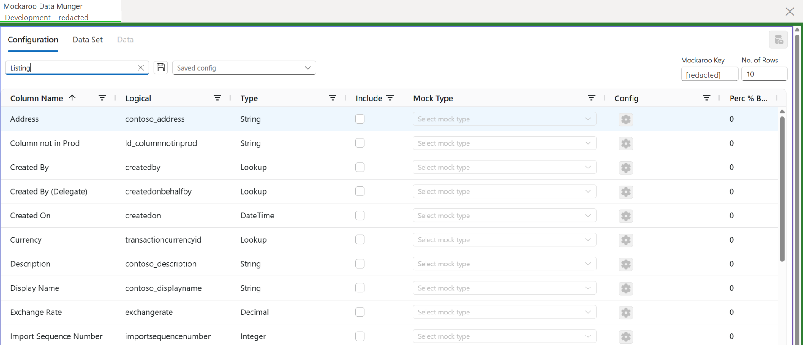

# Mockaroo Data Munger

Generate synthetic records with Mockaroo and create them in Dataverse. Configure fields for a table, preview the generated rows, and explicitly confirm before writing. Saved configurations can also be run as ordered datasets across multiple tables.

## Requirements

- Power Platform ToolBox 1.2.7 or later with an active Dataverse connection.
- A Mockaroo API key for configurations that use Mockaroo-generated fields. Fixed-value-only configurations do not need a key.
- Permission in the connected environment to create records in the selected tables.

## Use the tool

1. Select a Dataverse table and configure which columns to include and how to generate their values.
2. Enter your Mockaroo API key if the configuration uses Mockaroo fields, and choose a row count from 1 to 1,000.
3. Generate the data and review the resulting rows in the Data tab.
4. Choose **Create Data** and review the target environment, table, and record count. Confirm only if the target is correct.
5. To create data across several tables, save configurations, arrange them in a dataset, then choose **Review Dataset**. Review the environment, table-by-table counts, and any skipped steps before confirming.

Dataverse record creation has no automatic rollback. If a multi-batch or multi-step run fails, previously successful batches or steps may remain in Dataverse. The tool reports confirmed successful record counts; inspect the target environment before retrying.

## What this tool changes

- Reads table and column metadata and lookup/choice values from the active Dataverse connection.
- Creates new records only after an explicit confirmation. A dataset can create records in each configured table; each step is limited to 1,000 records.
- Saves the Mockaroo API key, saved configurations, and datasets in Power Platform ToolBox tool settings.
- Does not update or delete existing Dataverse records.
- Does not automatically roll back records created by a successful batch or dataset step if a later operation fails.

## Privacy and network access

When Mockaroo-generated fields are used, the tool sends the Mockaroo API key and generation schema/configuration to `https://api.mockaroo.com` over HTTPS to request synthetic data. Existing Dataverse records are not sent to Mockaroo. The API key is saved in ToolBox tool settings and is included in the Mockaroo API request. Use a key appropriate for your account and review Mockaroo's terms and privacy practices.

Mockaroo requests include configured field names, generation parameters, and selected choice values. Random lookup fields also send the selected existing Dataverse record IDs to Mockaroo. Lookup display names and full record contents are not included by this lookup-generation path.

The Content Security Policy exception for `https://api.mockaroo.com` is required for that request. No publisher-controlled telemetry endpoint is used by the tool.

## Screenshot

The screenshot below shows the tool running in Power Platform ToolBox. The Mockaroo API key and environment label have been redacted.

## Implementation and testing

See [IMPLEMENTATION.md](./IMPLEMENTATION.md) for technical notes, test responsibilities, and developer commands. The [manual testing checklist](./IMPLEMENTATION.md#manual-testing-checklist) documents the live PPTB and Dataverse checks required before submission.

## AI assistance

AI coding assistants contributed to this tool's implementation, tests, and documentation. The maintainer is responsible for reviewing the code, validating its behavior against a real environment, and maintaining the published tool.

## License

MIT

## Updates

### 2026-10-25

- Added explicit target and scope confirmations for record creation, bounded bulk writes, and clearer partial-failure reporting.
- Documented data handling and the required Mockaroo CSP access; added a tool-oriented marketplace icon.
- Added a redacted screenshot of the tool running in Power Platform ToolBox.
- Updated saved configuration and dataset-order lists to use Fluent theme colors in light and dark mode.
- Added a save icon to the Save Dataset button.
- Highlighted dataset creation rollback and skipped-step warnings in a warning message box.
- Moved the dataset review record total into the header, right-aligned at the same text size as the title.
- Set the minimum supported Power Platform ToolBox version to 1.2.7.
- Added an AI assistance disclosure and clarified maintainer responsibility.
- Added a manual acceptance checklist in IMPLEMENTATION.md for live PPTB and Dataverse testing before submission.
